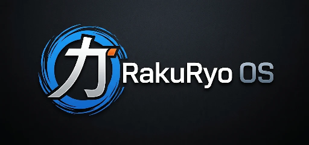

<p align="center">
  
</p>

# Ryoraku OS

**An atomic desktop distribution: RakuOS reliability + the Ryoku desktop.**

Ryoraku OS is a personal `bootc` distribution built from `quay.io/rakuos/rakuos-hyprland:latest`
(Fedora 45, Hyprland 0.57, `rum`, bootc) with the complete Ryoku 1.1.0 desktop baked into the image.

It is a **personal remix**, not an official Ryoku or RakuOS edition. Ryoku's Fedora installer
explicitly refuses atomic systems, so none of its runtime installer runs here — everything is
installed into the image at build time.

> There is no Arch/pacman layer in this image. Ryoku ships its desktop as signed **Fedora RPMs**,
> so both the RakuOS base and the Ryoku desktop are RPM-based.

Maintainers: see [MAINTAINING.md](MAINTAINING.md) for the publishing and testing runbook.

---

## Why this is a good idea

Ryoku is a deliberately rich, beautiful desktop — but its official Fedora edition only supports
**mutable** Fedora and explicitly refuses atomic systems. RakuOS is the opposite: a transactional,
image-based Fedora with instant rollback and a persistent package overlay. Until now you had to
choose: the desktop you want, or the base you trust.

Ryoraku OS removes that choice. It keeps the image you boot, the kernel, the signed modules, the
package overlay and the rollback model of RakuOS, and adds the full Ryoku shell, Hub, bar styles,
theming and compositor integration on top. The result is a desktop distribution with an
unusually strong safety net and a very small blast radius for experiments.

### Benefits

- **Best of both worlds.** RakuOS's atomic, image-based foundation with Ryoku's premium desktop
  instead of a bare compositor or a stock Plasma/GNOME session.
- **Transactional, recoverable updates.** Every system change is a new bootc deployment. A bad
  update cannot leave you with a half-upgraded system; `sudo bootc rollback && sudo reboot`
  returns to the previous deployment.
- **Try it without formatting.** `bootc switch --transport oci-archive` stages the new image next
  to the current one. `/home`, your files and your user config are untouched. This is a
  low-risk way to evaluate a different desktop on real hardware.
- **No rpm-ostree layering hell.** RakuOS's `rum` keeps your own packages in versioned package
  layers that survive image updates and reinstall from the distro repos — fast installs, no
  rebuilds, no manual reinstall after every upgrade.
- **Hardware support stays intact.** The image inherits RakuOS's signed kernel, MOK/Secure Boot
  setup, GPU enablement, Terra repositories and gaming focus. Ryoku brings Hyprland 0.57,
  niri, Quickshell 0.3.2, the Hub, Ryostore, wallpaper-driven theming and the bar styles.
- **One reproducible artifact.** The entire desktop is defined in a `Containerfile` plus small
  build scripts. It can be rebuilt, diffed, shared as an OCI archive, pushed to a registry, or
  run in CI — unlike a hand-configured desktop that only exists on one machine.
- **Clear separation of concerns.** The base image, your own packages and your dotfiles update
  on independent lanes, so a desktop experiment never has to destroy your package set or data.
- **Community-first and forkable.** Both upstreams are open source and GPL-3.0. Nothing here is
  a proprietary appliance: you can change the compositor, the bar, the branding or the base
  image and rebuild your own variant.

### Who it is for

Someone who likes Ryoku's desktop but wants an atomic base with reliable rollback; someone who
wants to learn how bootc images are assembled; or anyone who wants a testbed where "let's try a
different desktop" is a five-minute command rather than a backup-and-reinstall weekend.

---

## Install for end users (any country)

The GitHub Actions workflow publishes a ready-to-boot image to GHCR every week (and on demand).
There is no 5 GB download, no build step and no registry credentials — just a small image pull
from GitHub's CDN.

On a machine that already has RakuOS:

```sh
curl -fsSL https://raw.githubusercontent.com/DivinusX/ryoraku/master/install.sh | bash
```

Or manually:

```sh
sudo bootc switch --retain ghcr.io/divinusx/ryoraku:latest
sudo reboot
```

RakuOS's containers policy already allows `ghcr.io` without a signature, so no key or policy
editing is needed. At the greeter choose **Ryoku (Hyprland)**.

### Rollback — step by step

Every update is a new bootc deployment, and the previous one is never deleted. If an update
breaks something, you can go back in a couple of minutes. Nothing in `/home` or your user config
is lost.

**Case A — the system boots, but something is broken (shell, apps, drivers):**

1. Open a terminal and check what is currently booted:

   ```sh
   sudo bootc status
   ```

   You will see a `Booted image` and a `Rollback image`.

2. Set the previous deployment as the next boot target:

   ```sh
   sudo bootc rollback
   ```

3. Reboot:

   ```sh
   sudo reboot
   ```

4. After the reboot, confirm you are back on the older image:

   ```sh
   sudo bootc status
   ```

   The digest shown under `Booted image` should match the old `Rollback image` from step 1.

**Case B — the system does not boot at all:**

1. Power on and hold `Shift` (or press `Esc`) to show the GRUB menu.
2. Select the **older** deployment entry — the previous `RakuOS Hyprland` generation, not the
   newest `Ryoraku` entry. Boot it.
3. Once logged in, run `sudo bootc rollback && sudo reboot` so the bootloader keeps using that
   older deployment by default.

**After a rollback:**

- `sudo bootc upgrade` may immediately offer the same broken image again. Skip it until a newer
  image is published, or pin a known-good one with:

  ```sh
  sudo bootc switch ghcr.io/divinusx/ryoraku@sha256:<known-good-digest>
  ```

- To try the newest image again later, just run `sudo bootc upgrade`.
- If an app you installed yourself stops working after the switch, fix it with `rum update` or
  reinstall it with `rum install <package>` — the base rollback does not touch your own packages.

### Updates for end users

```sh
sudo bootc upgrade     # new RakuOS base + new Ryoku desktop, atomically
rum update             # refresh the packages you installed yourself
```

That is the whole maintenance routine. No archives, no local build, no cross-border file transfer.

---

## Status

The image is built as `localhost/ryoku-on-rakuos:test` and passes `./smoke-test.sh` (20 checks:
packages, shell QML, QML modules, i18n, session, first-login config). It was tested on a real
RakuOS laptop: switched in place, booted, and the Ryoku shell is active.

`bootc container lint` fails with `usr/sbin/chcon ... a path led outside of the filesystem` — the
**stock RakuOS Hyprland image fails the same check**, so this is an upstream image quirk, not
something introduced by the Ryoku layer.

---

## What the build does

1. Trusts Ryoku's release key (`EB6D…D6E3`) and adds the signed Fedora 45 RPM repository.
2. Builds a small `ryoku-rakuos-shims` RPM that Provides `snapper`, `grub2-tools`, `grubby`
   and `plymouth`. Ryoku's RPMs require these for its mutable-only update path; on a bootc host
   they are unnecessary, so no real snapshot/GRUB/Plymouth tooling is installed.
3. Installs `ryoku`, `ryoku-keyring`, `ryoku-desktop`, `ryoku-desktop-hyprland` and their
   dependencies with `rum`. Pre-creates `/var/usrlocal/share/applications` because RakuOS
   symlinks `/usr/local` there and the `ryoku-desktop` RPM would otherwise fail to unpack
   `mimeapps.list`.
4. Clones Ryoku `v1.1.0` and deploys the parts the RPMs do not ship: shell/Hub QML config,
   `Ryoku.Ui`, `Ryoku.PluginKit`, `Ryoku.FrameBars`, `Ryoku.Wm.Hyprland`, the i18n catalog and
   systemd user units.
5. Disables the RakuOS Noctalia **desktop shell** autostart (the Noctalia **greeter** stays for
   greetd), adds a `Ryoku (Hyprland)` Wayland session, sets `/usr/share/rakuos/de-name=ryoku`,
   marks the Ryoku packages protected, and seeds `/etc/skel` with `ryoku materialize`.
6. Repacks with the same pinned `chunkah` version as RakuOS and tags the result
   `containers.bootc=1`.

---

## Build

Requires `podman` (rootless is fine) and about 10 GB of free space. From this directory:

```sh
# 1. Stack the Ryoku layer and pack it into an OCI archive (writes ./out.ociarchive)
podman build --security-opt label=disable \
  --build-arg BASE_IMAGE_TAG=latest \
  -v "$(pwd)":/run/src \
  -t localhost/ryoku-on-rakuos-chunkah:temp \
  --target chunkah .

# 2. Build the final bootc image from that archive
podman build --security-opt label=disable \
  --build-arg BASE_IMAGE_TAG=latest \
  -v "$(pwd)":/run/src \
  -t localhost/ryoku-on-rakuos:test \
  --target final .

# 3. Export a portable OCI archive
podman save --format oci-archive -o ryoraku-os.image.tar localhost/ryoku-on-rakuos:test
```

Two stages are required because `FROM oci-archive:out.ociarchive` cannot be built in the same
invocation that produces the archive.

---

## Install on a laptop that already has RakuOS

RakuOS already ships `bootc`, `podman` and `skopeo`, so **no registry is needed**: `bootc switch`
accepts an OCI archive directly.

```sh
# Copy the archive to the laptop (scp, USB with exFAT/NTFS, or a local HTTP server)
scp ryoraku-os.image.tar user@laptop:~/
scp laptop-install.sh user@laptop:~/

# On the laptop
chmod +x laptop-install.sh
./laptop-install.sh ryoraku-os.image.tar
sudo reboot
```

At the greeter, choose **Ryoku (Hyprland)**. Secure Boot normally keeps working because the
kernel and modules are still RakuOS's.

`laptop-install.sh` runs `bootc switch --transport oci-archive --retain`, keeps the current
deployment for rollback, and temporarily adds an `oci-archive` exception to
`/etc/containers/policy.json` (RakuOS rejects unsigned images by default). The original policy
is restored automatically when the script exits.

### Rollback

```sh
sudo bootc rollback && sudo reboot
```

### First login on an existing user

`/etc/skel` only applies to newly created users. `ryoku-bootstrap` materializes the config on
first login; if the shell does not appear:

```sh
ryoku materialize
systemctl --user daemon-reload
systemctl --user start ryoku-session.target
mkdir -p ~/.config/systemd/user/graphical-session.target.wants
ln -sf ../ryoku-session.target ~/.config/systemd/user/graphical-session.target.wants/ryoku-session.target
```

---

## Simple update workflow (maintainers)

End users do **not** need this section — they just run `sudo bootc upgrade`.

When RakuOS or Ryoku publishes an update, the whole build side is one command on the build machine:

```sh
./update.sh
```

It pulls the newest RakuOS base image, checks GitHub for the newest Ryoku release (and updates
`build_files/RYOKU_REF` if needed — Ryoku RPMs are always taken fresh from the signed repo),
rebuilds both stages, exports `ryoraku-os.image.tar` and prints its SHA256.

Then, on the laptop:

```sh
# copy the two files over (scp / USB / local HTTP server)
./laptop-install.sh ryoraku-os.image.tar
sudo reboot
rum update
```

That updates the RakuOS base and the Ryoku desktop **together, atomically**, while `rum update`
refreshes only the packages you installed yourself. No formatting, no reinstall, and the previous
deployment stays available via `sudo bootc rollback`.

## Maintenance

Three independent update lanes:

| What | How | Command |
|---|---|---|
| Base RakuOS + baked-in Ryoku desktop | Rebuild the image and switch to the new archive | `bootc switch --transport oci-archive <new tar>` |
| Packages you installed yourself (rum overlay) | RakuOS package layers | `rum update` |
| User config | Persists; re-lay Ryoku's base config if needed | `ryoku materialize` |

Because the switch was made from a local archive, **`bootc upgrade` has no registry to pull
from**. Rebuild and re-run `laptop-install.sh` to update the system; it updates RakuOS and Ryoku
together in one atomic transaction. Pushing images to a registry such as
`quay.io/<you>/ryoraku:latest` makes `bootc upgrade` work normally, since RakuOS's policy already
accepts `quay.io` without a signature.

Never run these here:

```sh
ryoku update        # DNF + snapper + GRUB; for mutable Fedora only
sudo pacman -Syu    # there is no pacman in this image
sudo dnf install    # /usr is read-only; use rum
```

Keep the network connected during updates: RakuOS rebuilds your `rum` package layers from the
new image's repositories.

---

## Verification

```sh
./smoke-test.sh
podman run --rm -it --privileged localhost/ryoku-on-rakuos:test /bin/bash
```

---

## Known caveats

- **Hyprland plugin ABI.** Ryoku's plugins carry `.abi` receipts built against its own Hyprland;
  this image uses Hyprland 0.57.2. If a plugin fails to load, rebuild it with
  `ryoku-hub desktop plugins rebuild --stale`.
- **QML import path.** Modules live in `/usr/lib64/qt6/qml/Ryoku`; check `qs -c shell` from a TTY
  if the shell does not appear.
- **Lock screen.** Ryoku's qylock SDDM greeter theme is not wired up; the in-session Quickshell
  lockscreen is used instead.
- **Broken overlay apps.** Packages whose dependencies were absent in the new image (e.g. Firefox
  needing openh264, or Edge) are skipped during the switch. Reinstall them with `rum install`.
- **Fedora release alignment.** Ryoku only publishes RPMs for Fedora 44/45. When RakuOS moves to
  a new Fedora release, wait for matching Ryoku packages or build them locally.

---

## Licensing

Ryoku is GPL-3.0; the upstream license is included as `LICENSE`. A personal image is fine. If you
distribute it, honour the GPL source/notice obligations for the Ryoku packages and keep the
upstream `NOTICE` files.

## Upstream references

- RakuOS Hyprland image: https://gitlab.com/rakuos/images/rakuos-hyprland
- RakuOS: https://gitlab.com/rakuos · https://rakuos.org
- Ryoku: https://github.com/Ryoku-dev/ryoku · repo `https://repo.ryoku.dev/stable/fedora/$releasever/x86_64`
